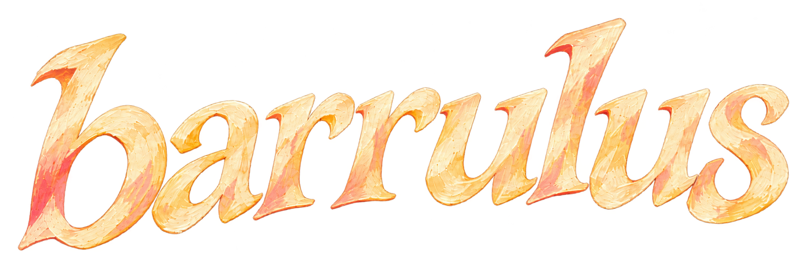
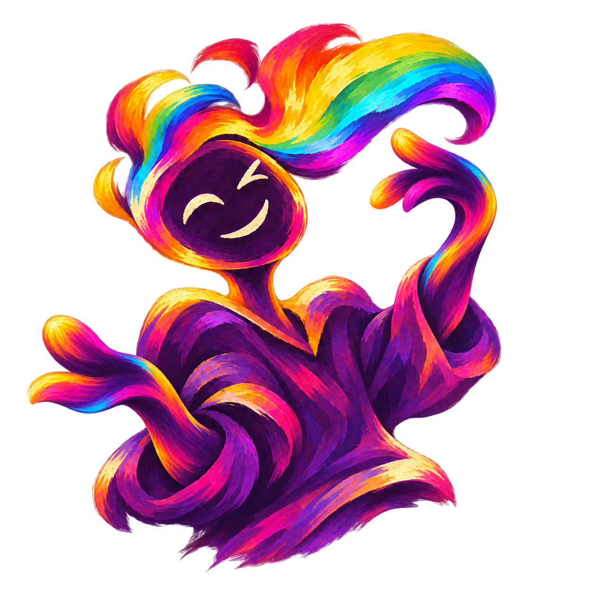

  

  <strong>Worlds to generate. Desktops to tinker with. Cursors to set on fire.</strong>
   
  A small corner of GitHub with a suspicious number of side quests.

  <a href="https://github.com/barrulus?tab=repositories">Explore the repos</a>
  &nbsp; · &nbsp;
  <a href="https://github.com/barrulus/settlemaker">Build a city</a>
  &nbsp; · &nbsp;
  <a href="https://github.com/barrulus/forge-cursor">Ignite your cursor</a>

---

## Hey, I'm barrulus 

Welcome to my lab. Around here, a map can become a world, a desktop can become a playground, and an Emacs cursor can become a tiny welding torch.

My work wanders through **Linux & Wayland**, **procedural generation**, **creative tools**, and **developer workflows**. I contribute across a wide range of open-source projects, following interesting ideas wherever they lead.

The recurring question: *“What if it did something a bit more fun?”*

If ou're enjoying things I do, please support me on [Ko-Fi](https://ko-fi.com/barrulus)

 

##  What I'm playing with

| Project | What you'll find |
| :--- | :--- |
|  **[Umbriel](https://github.com/noctalia-dev/umbriel)** | A Wayland compositor with scrolling, dwindle and master layouts, blur, shadows, and fluid animations. A desktop worth getting distracted by. |
| ️ **[rummage](https://github.com/barrulus/rummage)** | A native Wayland file manager built with C++ and OpenGL ES. A little rummaging is part of the process. |
|  **[Community Umbriel Shaders](https://github.com/noctalia-dev/community-umbriel-shaders)** | I manage this collection of reusable GLSL effects for Umbriel. Bring your pixels; we'll give them something to do. |
| ️ **[Fantasy Map Generator](https://github.com/Azgaar/Fantasy-Map-Generator)** | Interactive, customisable maps, with me on the maintenance team. Here be dragons; geography first. |
| ️ **[Hesiod](https://github.com/ottolink-dev/Hesiod)** | Node-based procedural terrain generation, where I'm also on the maintenance team. Mountains, with an undo button. |
|  **[forge-cursor](https://github.com/barrulus/forge-cursor)** | Welding sparks, comet streaks, and pulsar flashes for Emacs. The cursor has stage presence now. |
|  **[settlemaker](https://github.com/barrulus/settlemaker)** | A TypeScript reimplementation of watabou's Medieval Fantasy City Generator. Tiny streets, big daydreams. |
|  **[biri](https://github.com/barrulus/biri)** | A scrollable-tiling Wayland compositor based on niri. Another window? Keep scrolling. |
|  **[agentcanvas](https://github.com/barrulus/agentcanvas)** | A spatial canvas for orchestrating AI agents, with support for Claude Code and Ollama. Give the agents some elbow room. |
|  **[clepho](https://github.com/barrulus/clepho)** | A Rust TUI for cleaning up photo stores. Even the photo pile deserves a little order. |
|  **[log-vector](https://github.com/barrulus/log-vector)** | System logs indexed into a vector database for natural-language exploration. Ask the logs what happened. |

---

  
   
  <strong>Make useful things. Add a little colour. Follow the interesting thing.</strong>
   
  Thanks for stopping by!

